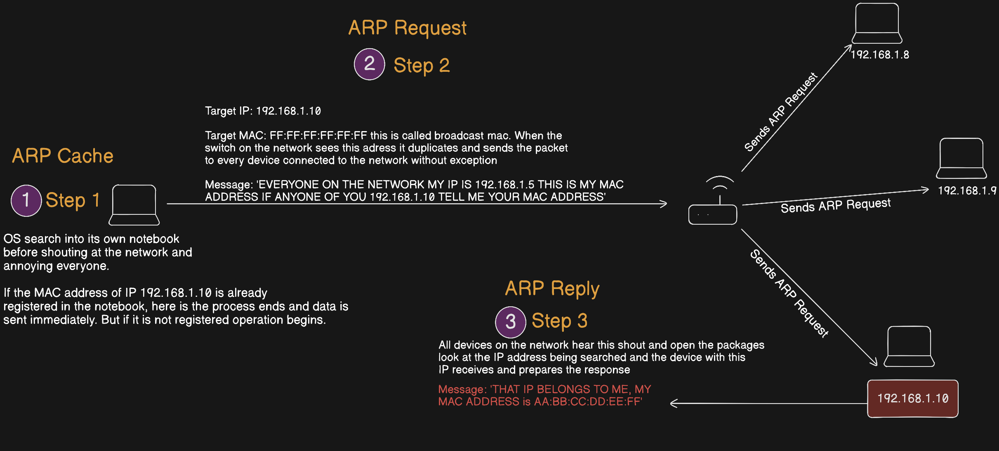

# Network Scanner By Efe Ozel

First i have to choose which protocol to use

I thought it was ICMP or APR bu i selected ARP because ICMP blocking most machine or servers.

### First we need to understand what is the ARP and how it can work?

ARP (Address Resolution Protocol) is a technology that allows devices to identify themselves on a network

Simply ARP allows a device to associate its MAC address with an IP address on the network. Each device on the network keeps a record of the MAC addresses associated with other devices.

When devices want to communicate with each other, they send a call to the entire network to look for specific device. They send broadcast. Devices use the MAC address to find the MAC address of the device they will communicate with. Then Can use ARP.

And here we we will write a script that works with this logic but does not have a single target, sends ARP request to 254 different IP addresses at the same time and shows these answers to the user.

### Imports:

For the send network packet i used scapy. Scapy today it is the industry standart for pentesting, network analysis and protocol research.

What it is doing?

- Creating packet
- Sends packet and received
- Network traffic sniffing
- Protocol Analysis
- Fuzzing

Before i continue i wanted to imagine in my mind what i should do.

-I need to take IP address range from the user input.

-With this IP address i need to create an arp request packet this ip addres or ip address range is it will be our destination

-In addition in order to distribute the arp request to all devices over the router we must send the arp request using the broadcast speacial mac address.

## get_ipaddress()

With the optparse library we need to take a ip address from the user. When user scan the network we need to know what user want scan ip address or range

This metod should take ip address from the user and then return this.

## start_scan()

After we taken user input, we need to start the scan with scapy functions. For the learn scapy you can read documentacion or like this source

Line 1 - Create ARP Packet

> arp_request_packet = scapy.ARP(pdst=options.ipaddress):
> 

`scapy.ARP():` Scapy’s ARP class. It creates an ARP packet object.

`pdst:`  Protocol Destination

Line 2 - Create Ethernet Frame 

> broadcast_packet = scapy.Ether(dst="ff:ff:ff:ff:ff:ff")
> 

`scapy.Ether():` Creates a Layer 2 Ethernet frame

`dst="ff:ff:ff:ff:ff:ff”:` We already explain, what does mean it is

Line 3 - Combine Packets

> combined_packet = broadcast_packet/arp_request_packet
> 

Scapy combine the packets with “/” operator.

Line 4 - Send and Receive Answers

> (answered_list, unanswered_list) = scapy.srp(combined_packet, timeout=1)
> 

`scapy.srp():` ”Sends and Receive Packets” In the Layer 2 send packets and receive answers

Why we used srp()? 

- Because ARP is in the Layer 2

Return 2 list:

`answered_list:` responding devices

`unanswered_list:` IP addresses that do not respond

Line 5 - Show output

> answered_list.summary()
> 

`.summary():`  Scapy built-in summary method. It summarises each packet in a single line

## Usage

`sudo python [netscanner.py](http://netscanner.py) -i [Target IP address range]`

## Full Package Flow

Efe Ozel - SOC Analyst